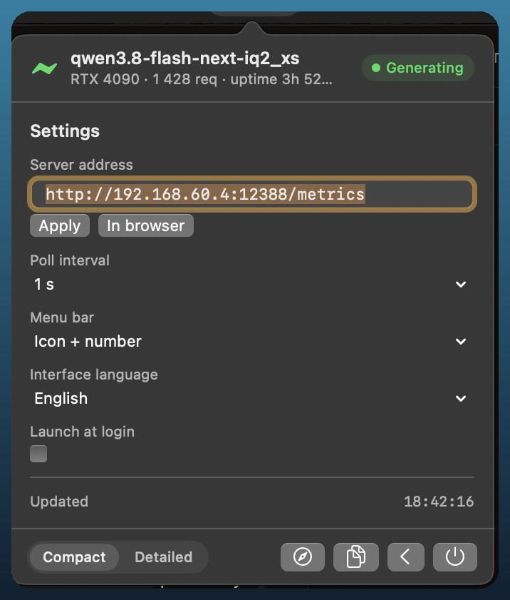

# Strata Monitor for macOS

A native macOS menu bar app that watches a [Strata](https://github.com/Niko1221/Strata) inference server: live tokens/s in the menu bar, GPU state, engine internals and request history — without keeping a browser tab open.

[English](README.md) · [Русский](README.ru.md)


## Why

Strata ships a web monitor, but it lives in a browser tab: you have to switch
windows to find out whether the GPU is still generating, and at what speed. This
app puts the same information in the macOS menu bar and keeps it one click away.

## Screenshots

| Menu bar | Compact panel |
|---|---|
|  |  |

| Detailed panel | Settings |
|---|---|
|  |  |

| First run | Server unreachable |
|---|---|
|  |  |

## Features

- **Menu bar item** — a bolt icon plus the live decode speed in tok/s.
  Green while decoding, amber while the prompt is being read, grey when idle,
  red with a slash when the server cannot be reached.
- **Three levels of detail** — compact panel with the essentials, detailed panel
  with engine internals, cache statistics, session totals and a table of recent
  requests.
- **Live numbers** — the panel shows the decode speed of the *running* request,
  not the last finished one, plus the prefill (prompt read) rate.
- **Any address** — the Strata server may run on the same Mac or on another
  machine in the LAN; the address is configurable.
- **Russian and English** — switch the interface language in the settings.
- **No dependencies** — Swift + SwiftUI only, no package managers, no runtime to
  install. The app is a single ~700 KB binary.
- **Launch at login** — optional, via a LaunchAgent.

## Requirements

- macOS 14 (Sonoma) or newer, Apple silicon or Intel.
- A reachable Strata server. Strata exposes its metrics at
  `http://<host>:<port>/metrics` (port `12388` by default).

## Install

### Download a release

Grab `StrataMonitor.zip` from the [releases page](https://github.com/michael-korotaev/strata-macos-monitor/releases),
unzip it and move `StrataMonitor.app` to `/Applications`.

The app is ad-hoc signed, so macOS may ask you to confirm the first launch:
right-click the app → **Open** → **Open**.

### Build from source

```bash
git clone https://github.com/michael-korotaev/strata-macos-monitor.git
cd strata-macos-monitor
./build.sh
open dist/StrataMonitor.app
```

Requirements: Xcode Command Line Tools (Swift 6.4) on macOS 14+.

## Configuration

Click the menu bar icon, then the gear icon at the bottom of the panel.

| Setting | Meaning |
|---|---|
| Server address | The metrics endpoint, e.g. `http://192.168.1.10:12388/metrics`. The default is `http://localhost:12388/metrics`. |
| Poll interval | 0.5 s / 1 s / 2 s / 5 s. The server keeps a 60-sample history, so 1 s is a good default. |
| Menu bar | Icon + number, number only, or icon only. |
| Interface language | Russian or English. |
| Launch at login | Installs a LaunchAgent in `~/Library/LaunchAgents`. |

On the first launch the panel asks for the server address, so nothing has to be
edited by hand.

## What is shown

Everything comes from a single request to `GET /metrics`:

| Block | Used for |
|---|---|
| `live` | Current state (`idle` / `reading` / `generating`), phase, live tok/s, mean tok/s, prefill rate, generated tokens |
| `hardware` | GPU utilisation, VRAM, temperature, power, PCIe throughput, CPU, RAM, disk |
| `hardware_static` | GPU and CPU model names |
| `history` | 60 samples (about one per second) — used for the sparklines |
| `requests` | Recent requests with decode speed, time to first token and speculative decoding acceptance |
| `totals`, `conversation_cache`, `engine` | Session totals, conversation cache hit rate, engine configuration |

The JSON is parsed defensively: unknown fields are ignored and missing ones
simply do not appear in the UI, so a Strata update will not break the monitor.

## Troubleshooting

**The icon is red with a slash.** The server is unreachable. Check the address
in the settings and that the Strata server is actually running.

**macOS asks for local network access.** Strata usually runs on another
machine in the LAN; macOS 15+ asks for permission the first time an app talks to
the local network. Allow it in *System Settings → Privacy & Security → Local
Network*.

**The speed stays at zero.** The server only reports a speed while a request is
being processed. Send a request to Strata and watch the menu bar.

**The interface is empty.** The Strata build you run may not expose `/metrics`.
Open `http://<host>:<port>/metrics` in a browser: you should see a JSON object
with a `live` key.

## Development

```bash
swift build -c release   # build
swift test               # unit tests (parsing of a real /metrics payload)
./build.sh               # build + assemble dist/StrataMonitor.app + zip
swift scripts/make-icon.swift   # regenerate Resources/AppIcon.icns
```

Useful flags:

```bash
# one-shot metrics snapshot in stdout (diagnostics)
./dist/StrataMonitor.app/Contents/MacOS/StrataMonitor --dump
STRATA_ENDPOINT=http://other-host:12388/metrics ... --dump

# start with the settings panel open
open -a dist/StrataMonitor.app --args --settings
```

The project has two targets:

- `StrataMonitorKit` — metrics client, JSON parsing, state model and the ru/en
  string tables. No UI, fully unit tested.
- `StrataMonitor` — the menu bar app: `NSStatusItem`, popover, settings.

The menu bar item is drawn with AppKit (`NSStatusItem`) rather than
`MenuBarExtra`, because a menu bar label has to combine an SF Symbol with a
monospaced number.

The screenshots in `docs/` are produced by `scripts/clean-screenshot.py`: it
cuts the popover out of a screen capture and puts it on a clean gradient, so
no other windows leak into the picture.

## License

MIT — see [LICENSE](LICENSE).

## Credits

- [Strata](https://github.com/Niko1221/Strata) by Niko1221 — the inference server
  this app monitors.
