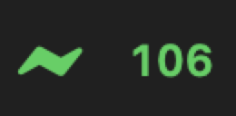
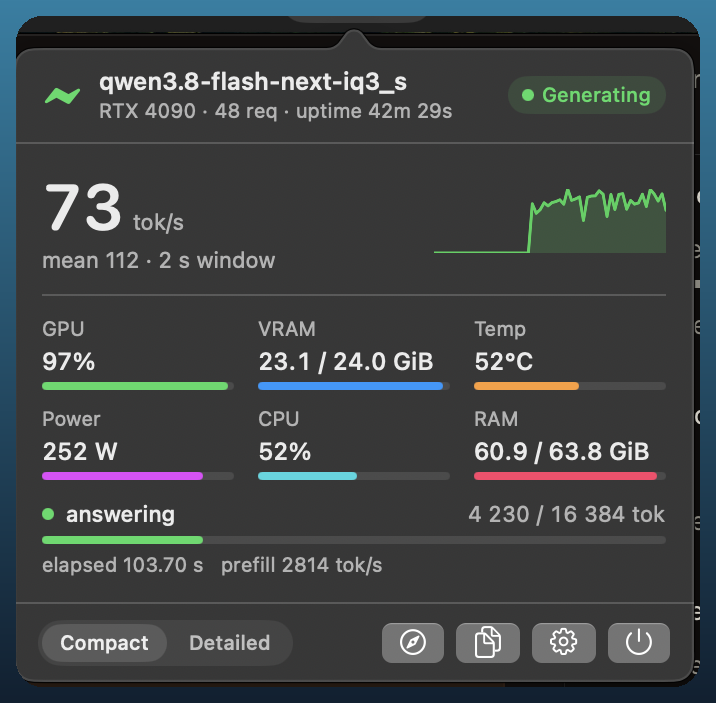
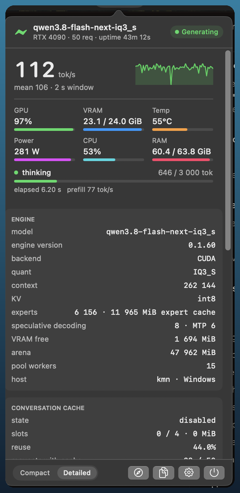
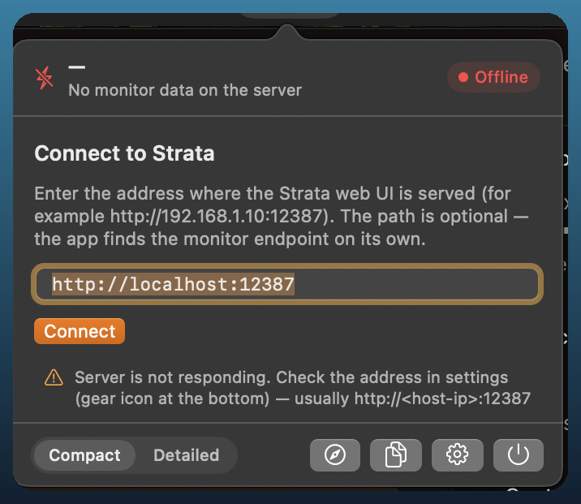
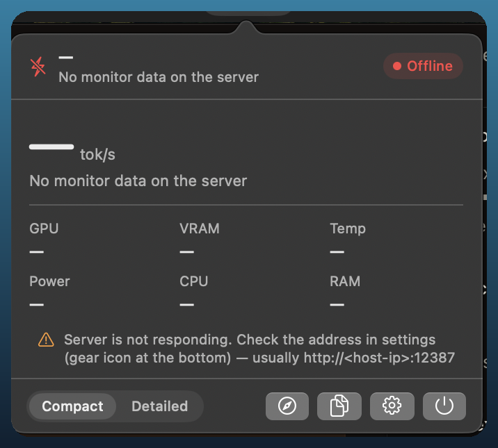

# Strata Monitor for macOS

A native macOS menu bar app that watches a [Strata](https://github.com/Niko1221/Strata) inference server: live tokens/s in the menu bar, GPU state, engine internals and request history — without keeping a browser tab open.

[English](README.md) · [Русский](README.ru.md)




## Why

Strata ships a web monitor, but it lives in a browser tab: you have to switch
windows to find out whether the GPU is still generating, and at what speed. This
app puts the same information in the macOS menu bar and keeps it one click away.

## Screenshots

| Menu bar | Compact panel |
|---|---|
|  |  |

| Detailed panel | Settings |
|---|---|
|  |  |

| First run | Server unreachable |
|---|---|
|  |  |

## Features

- **Menu bar item** — a bolt icon plus the live decode speed in tok/s.
  Green while decoding, amber while the prompt is being read, grey when idle,
  red with a slash when the server cannot be reached.
- **Three levels of detail** — compact panel with the essentials, detailed panel
  with engine internals, cache statistics, session totals and a table of recent
  requests.
- **Live numbers** — the panel shows the decode speed of the *running* request,
  not the last finished one, plus the prefill (prompt read) rate.
- **Any address** — the Strata server may run on the same Mac or on another
  machine in the LAN; the address is configurable.
- **Both Strata installations** — the source build (`git clone`) and the
  desktop application speak different APIs; the app understands both and finds
  the right endpoint on its own.
- **Russian and English** — switch the interface language in the settings.
- **No dependencies** — Swift + SwiftUI only, no package managers, no runtime to
  install. The app is a single ~700 KB binary.
- **Launch at login** — optional, through the system Login Items list.

## Requirements

- macOS 14 (Sonoma) or newer, Apple silicon or Intel.
- A reachable Strata server. Strata is installed in two ways and each one
  exposes its metrics differently:

  | Installation | Where the live numbers live | Typical port |
  |---|---|---|
  | Source build (`git clone`) | `GET /metrics` | 12388 |
  | Desktop application | event stream `GET /api/events` (event `native`), `GET /api/monitor` as a fallback | 12387 |

  The app probes both, so it does not matter which one you run. See
  [Configuration](#configuration).

## Install

### Download a release

Grab `StrataMonitor.zip` from the [releases page](https://github.com/michael-korotaev/strata-macos-monitor/releases),
unzip it and move `StrataMonitor.app` to `/Applications`.

The app is ad-hoc signed, so macOS may ask you to confirm the first launch:
right-click the app → **Open** → **Open**.

### Build from source

```bash
git clone https://github.com/michael-korotaev/strata-macos-monitor.git
cd strata-macos-monitor
./build.sh
open dist/StrataMonitor.app
```

Requirements: Xcode Command Line Tools (Swift 6.4) on macOS 14+.

## Configuration

Click the menu bar icon, then the gear icon at the bottom of the panel.

| Setting | Meaning |
|---|---|
| Server address | Where the Strata web UI is served, e.g. `http://192.168.1.10:12387`. The path is optional — the app finds the metrics endpoint itself. |
| Strata installation | `Detect automatically` (default), `Source build (git)` or `Desktop application`. Only needed if the automatic detection picks the wrong one. |
| Poll interval | 0.5 s / 1 s / 2 s / 5 s. The server keeps a 60-sample history, so 1 s is a good default. |
| Menu bar | Icon + number, number only, or icon only. |
| Interface language | Russian or English. |
| Launch at login | Adds the app to the system Login Items list (macOS 13+ API). |

On the first launch the panel asks for the server address, so nothing has to be
edited by hand.

**How the endpoint is found.** The app first tries the address as it is, then
the known paths on that host (`/api/monitor` for the desktop application,
`/metrics` for a source build), then the same host on the other well-known
port (12387 and 12388). The address that answered is remembered, so the search
happens only once — and again only if the server moves its endpoints.

The desktop application keeps the live numbers (phase, tokens/s, the counters of
the running request) out of its plain HTTP responses: they only come through
the event stream `GET /api/events`, in the `native` event. The app opens that
stream when it sees a desktop installation and falls back to plain polling if
the stream is not there.

To see what the app found, run the diagnostic mode:

```bash
./dist/StrataMonitor.app/Contents/MacOS/StrataMonitor --dump
```

It prints the resolved endpoint, the detected installation and the current
readings.

## What is shown

Everything comes from one place — `GET /metrics` for a source build, the event
stream `GET /api/events` for the desktop application (and `GET /api/monitor`
when the stream is not available):

| Block | Used for |
|---|---|
| `live` / `phase` | Current state (`idle` / `reading` / `generating`), phase, live tok/s, mean tok/s, prefill rate, generated tokens |
| `hardware` | GPU utilisation, VRAM, temperature, power, PCIe throughput, CPU, RAM, disk |
| `hardware_static` | GPU and CPU model names (a source build; a desktop application serves them in `GET /api/hardware`) |
| `history` | 60 samples (about one per second) — used for the sparklines |
| `requests` | Recent requests with decode speed, time to first token and speculative decoding acceptance |
| `totals`, `conversation_cache`, `engine` | Session totals, conversation cache hit rate, engine configuration |

The JSON is parsed defensively: unknown fields are ignored and missing ones
simply do not appear in the UI, so a Strata update will not break the monitor.
The desktop application keeps some data in separate endpoints
(`GET /api/hardware` and `GET /api/models`); the app reads them once a minute
and shows the GPU and CPU names, the core count and the parameters of the
loaded model.

## Troubleshooting

**The icon is red with a slash.** The server is unreachable. Check the address
in the settings and that the Strata server is actually running. The address is
the web UI address, for example `http://192.168.1.10:12387`.

**macOS asks for local network access.** Strata usually runs on another
machine in the LAN; macOS 15+ asks for permission the first time an app talks to
the local network. Allow it in *System Settings → Privacy & Security → Local
Network*.

**The speed stays at zero.** The server only reports a speed while a request is
being processed. Send a request to Strata and watch the menu bar.

**The desktop application shows `idle` while Strata is generating.** The live
numbers of the desktop build come from the event stream `GET /api/events`, in
the `native` event. Run `--dump` during a request: the `live state:` line must
change from `idle` to `generating`. If it stays `idle`, the server does not
send that event (an older build) — then the panel shows the finished requests
only.

**The interface is empty.** Run `--dump` and look at the `installation:` line —
it tells you which flavour the app detected. If it says `source build` but you
run the desktop application (or the other way round), pick the right one in
the settings.

## Development

```bash
swift build -c release   # build
swift test               # unit tests (parsing of real payloads of both Strata installations)
./build.sh               # build + assemble dist/StrataMonitor.app + zip
swift scripts/make-icon.swift   # regenerate Resources/AppIcon.icns
```

Useful flags:

```bash
# one-shot metrics snapshot in stdout (diagnostics)
./dist/StrataMonitor.app/Contents/MacOS/StrataMonitor --dump
STRATA_ENDPOINT=http://other-host:12387 ... --dump

# start with the settings panel open
open -a dist/StrataMonitor.app --args --settings

# manage the "launch at login" registration from the shell
./dist/StrataMonitor.app/Contents/MacOS/StrataMonitor --login-item status
./dist/StrataMonitor.app/Contents/MacOS/StrataMonitor --login-item on
./dist/StrataMonitor.app/Contents/MacOS/StrataMonitor --login-item off
```

Only one copy of the app runs at a time: a second launch (from Finder, from the
dock or from the login item) sees the lock of the running instance and quits
immediately, so the menu bar never gets a duplicate icon.

The project has two targets:

- `StrataMonitorKit` — metrics client, JSON parsing, state model and the ru/en
  string tables. No UI, fully unit tested.
- `StrataMonitor` — the menu bar app: `NSStatusItem`, popover, settings.

Both Strata installations are parsed by the same model: `MetricsPayload` reads
the new fields first and falls back to the old ones, so a field that only one
of the two has is simply optional. `StaticInfo` covers the desktop
application's extra endpoints (`/api/hardware`, `/api/models`).

The desktop application is read through the event stream: `EventStream` is a
small Server-Sent Events client (`URLSessionDataDelegate`), `MetricsClient`
opens `GET /api/events` and prefers the metrics of the engine from the `native`
event over the flat `monitor` event.

The menu bar item is drawn with AppKit (`NSStatusItem`) rather than
`MenuBarExtra`, because a menu bar label has to combine an SF Symbol with a
monospaced number.

The screenshots in `docs/` are produced by `scripts/clean-screenshot.py`: it
cuts the popover out of a screen capture and puts it on a clean gradient, so
no other windows leak into the picture.

## License

MIT — see [LICENSE](LICENSE).

## Credits

- [Strata](https://github.com/Niko1221/Strata) by Niko1221 — the inference server
  this app monitors.
