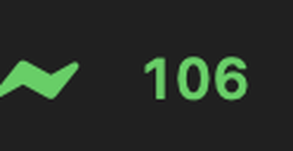
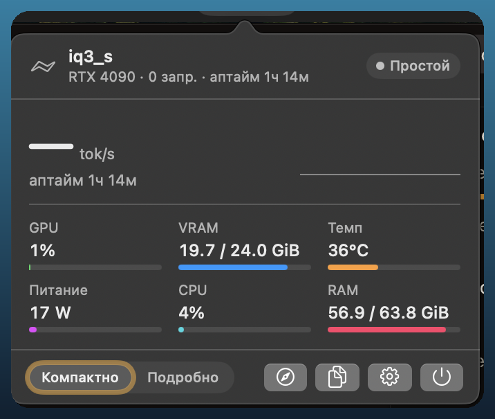
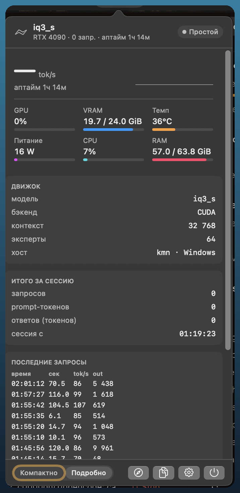
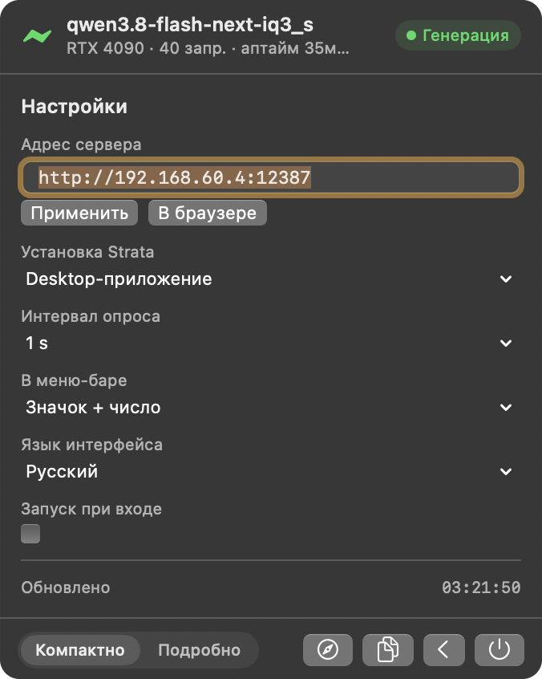
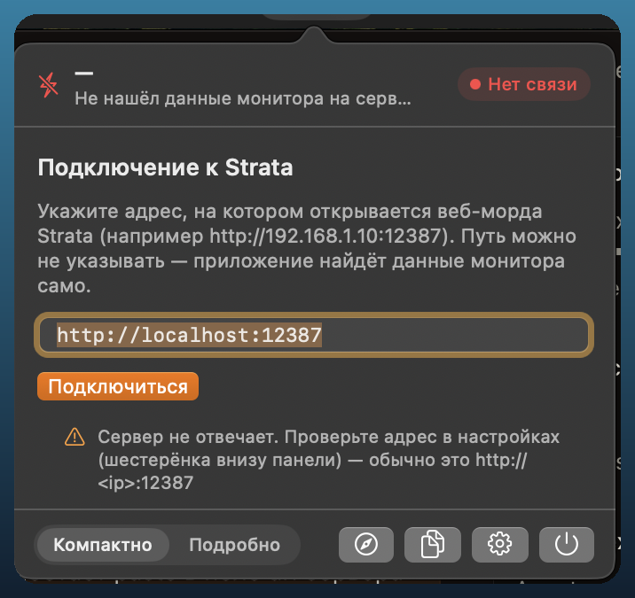
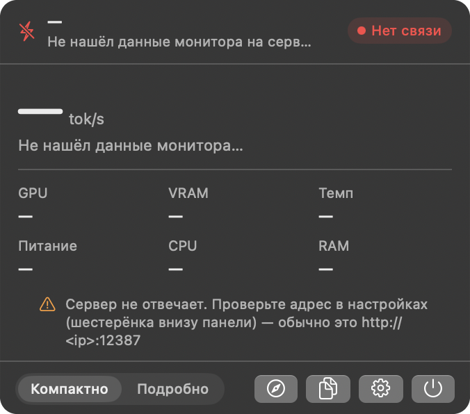

# Strata Monitor для macOS

Нативное приложение для macOS, которое следит за сервером инференса [Strata](https://github.com/Niko1221/Strata): живые токены/с в меню-баре, состояние видеокарты, внутренности движка и история запросов — без открытой вкладки в браузере.

[English](README.md) · [Русский](README.ru.md)




## Зачем

У Strata есть веб-морда, но она живёт в вкладке браузера: чтобы узнать, работает
ли ещё карта и с какой скоростью, надо переключаться между окнами. Это
приложение показывает то же самое прямо в меню-баре macOS, в один клик от
всегда.

## Скриншоты

| Меню-бар | Компактная панель |
|---|---|
|  |  |

| Подробная панель | Настройки |
|---|---|
|  |  |

| Первый запуск | Сервер недоступен |
|---|---|
|  |  |

## Возможности

- **Значок в меню-баре** — молния и живая скорость декода в tok/s. Зелёная во
  время генерации, жёлтая при чтении промпта, серая в простое, красная с
  перечёркнутой молнией, когда сервер недоступен.
- **Три уровня детализации** — компактная панель с главным, подробная панель с
  внутренностями движка, статистикой кеша, итогами сессии и таблицей последних
  запросов.
- **Живые числа** — в панели видна скорость *текущего* запроса, а не последнего
  завершённого, плюс скорость чтения промпта (prefill).
- **Любой адрес** — сервер Strata может работать на этом же Mac или на другой
  машине в локалке; адрес настраивается.
- **Обе установки Strata** — сборка из исходников (`git clone`) и desktop-приложение
  отдают данные по-разному; приложение понимает оба варианта и само находит нужный
  адрес.
- **Русский и английский** — язык интерфейса переключается в настройках.
- **Без зависимостей** — только Swift и SwiftUI, без менеджеров пакетов и без
  рантайма. Приложение — один бинарь ~700 КБ.
- **Запуск при входе** — опционально, через системный список Login Items.

## Требования

- macOS 14 (Sonoma) или новее, Apple silicon или Intel.
- Доступный сервер Strata. Ставится он двумя способами, и метрики у них по
  разным адресам:

  | Установка | Где лежат живые цифры | Типичный порт |
  |---|---|---|
  | Сборка из исходников (`git clone`) | `GET /metrics` | 12388 |
  | Desktop-приложение | поток событий `GET /api/events` (событие `native`), `GET /api/monitor` — запасной вариант | 12387 |

  Приложение пробует оба, поэтому не важно, какой вариант у вас. Подробнее — в
  разделе [Настройки](#настройки).

## Установка

### Готовый релиз

Скачайте `StrataMonitor.zip` со [страницы релизов](https://github.com/michael-korotaev/strata-macos-monitor/releases),
распакуйте и перенесите `StrataMonitor.app` в `/Applications`.

Приложение подписано ad-hoc, поэтому при первом запуске macOS может спросить
подтверждение: правый клик по иконке → **Открыть** → **Открыть**.

### Сборка из исходников

```bash
git clone https://github.com/michael-korotaev/strata-macos-monitor.git
cd strata-macos-monitor
./build.sh
open dist/StrataMonitor.app
```

Нужны Xcode Command Line Tools (Swift 6.4) и macOS 14+.

## Настройки

Клик по значку в меню-баре → шестерёнка внизу панели.

| Настройка | Значение |
|---|---|
| Адрес сервера | Куда отдаётся веб-морда Strata, например `http://192.168.1.10:12387`. Путь можно не указывать — адрес метрик приложение найдёт само. |
| Установка Strata | `Определить автоматически` (по умолчанию), `Сборка из исходников (git)` или `Desktop-приложение`. Нужно только если автоопределение ошиблось. |
| Интервал опроса | 0.5 с / 1 с / 2 с / 5 с. Сервер хранит историю за 60 сэмплов, поэтому 1 с — хороший дефолт. |
| В меню-баре | Значок + число, только число или только значок. |
| Язык интерфейса | Русский или английский. |
| Запуск при входе | Добавляет приложение в системный список Login Items (API macOS 13+). |

При первом запуске панель сама спросит адрес сервера — руками ничего править не
нужно.

**Как ищется адрес.** Сначала приложение пробует указанный адрес как есть, затем
известные пути на этом хосте (`/api/monitor` для desktop-приложения, `/metrics`
для сборки из исходников), затем тот же хост на втором стандартном порту (12387
и 12388). Сработавший адрес запоминается, поэтому поиск случается один раз — и
повторяется, только если сервер снова переедет.

Живые цифры (фаза, tok/s, счётчики текущего запроса) desktop-приложение в
обычных HTTP-ответах не отдаёт — они приходят только через поток событий
`GET /api/events`, в событии `native`. Увидев desktop-установку, приложение
открывает этот поток, а если его нет — откатывается на обычный опрос.

Посмотреть, что приложение нашло, можно диагностическим режимом:

```bash
./dist/StrataMonitor.app/Contents/MacOS/StrataMonitor --dump
```

Он печатает найденный адрес, определённый тип установки и текущие показатели.

## Что показывается

Всё берётся из одного места — `GET /metrics` для сборки из исходников, поток
событий `GET /api/events` для desktop-приложения (и `GET /api/monitor`, если
потока нет):

| Блок | Что используется |
|---|---|
| `live` / `phase` | Текущее состояние (`idle` / `reading` / `generating`), фаза, живые tok/s, средние tok/s, скорость префилла, сгенерированные токены |
| `hardware` | Загрузка GPU, VRAM, температура, питание, пропускная способность PCIe, CPU, RAM, диск |
| `hardware_static` | Названия GPU и CPU (у сборки из исходников; desktop-приложение отдаёт их в `GET /api/hardware`) |
| `history` | 60 сэмплов (примерно по одному в секунду) — из них строятся графики |
| `requests` | Последние запросы: скорость декода, время до первого токена, доля принятых драфтов |
| `totals`, `conversation_cache`, `engine` | Итоги сессии, доля попаданий кеша диалогов, конфигурация движка |

JSON разбирается defensively: неизвестные поля игнорируются, а отсутствующие
просто не показываются — обновление Strata не сломает монитор.
В desktop-приложении часть данных лежит в отдельных адресах (`GET /api/hardware`
и `GET /api/models`): приложение читает их раз в минуту и показывает названия
GPU и CPU, число ядер и параметры загруженной модели.

## Если что-то не работает

**Значок красный, с перечёркнутой молнией.** Сервер недоступен. Проверьте адрес
в настройках и что Strata вообще запущен. Адрес — это адрес веб-морды,
например `http://192.168.1.10:12387`.

**После обновления Strata Desktop монитор пишет «Нет связи», хотя `/v1`
работает.** Strata Desktop 1.1 проверяет заголовок `Host` у своего control API.
С другой машины `GET /api/*` отвечает `403 {"code":"bad-host"}` («Open the local
Strata app to use host controls»), если в запросе не loopback-имя. Монитор
распознаёт этот ответ, повторяет GET с `Host: localhost:<port>` и запоминает
это на сессию — настраивать ничего не нужно. Обновление не затрагивает
OpenAI-совместимый `/v1` на отдельном порту, поэтому сама модель продолжает
работать. Если Strata стоит за reverse proxy, добейтесь, чтобы прокси
сохранял `Host`, или добавьте внешнее имя в `STRATA_ALLOWED_HOSTS` на машине
со Strata.

**macOS просит доступ к локальной сети.** Strata обычно живёт на другой
машине, и macOS 15+ спрашивает разрешение при первом обращении к локалке.
Разрешите в *Системных настройках → Конфиденциальность и безопасность →
Локальная сеть*.

**Скорость всё время нулевая.** Сервер отдаёт скорость только пока идёт
запрос. Отправьте запрос в Strata и посмотрите на меню-бар.

**Desktop-приложение показывает `Простой`, хотя Strata генерация идёт.** Живые
цифры desktop-сборки приходят из потока событий `GET /api/events`, в событии
`native`. Запустите `--dump` во время запроса: строка `live state:` должна
смениться с `idle` на `generating`. Если осталась `idle`, сервер такое событие
не присылает (старая сборка) — тогда панель показывает только завершённые
запросы.

**Панель пустая.** Запустите `--dump` и посмотрите на строку `installation:` —
она показывает, какой вариант определило приложение. Если написано
`source build`, а у вас desktop-приложение (или наоборот), выберите правильный
в настройках.

## Разработка

```bash
swift build -c release          # сборка
swift test                      # тесты (разбор реальных ответов обеих установок Strata)
./build.sh                      # сборка + dist/StrataMonitor.app + zip
swift scripts/make-icon.swift   # перегенерировать Resources/AppIcon.icns
```

Полезные ключи запуска:

```bash
# срез метрик в stdout (диагностика)
./dist/StrataMonitor.app/Contents/MacOS/StrataMonitor --dump
STRATA_ENDPOINT=http://other-host:12387 ... --dump

# открыть панель сразу с настройками
open -a dist/StrataMonitor.app --args --settings

# управление автозапуском из консоли
./dist/StrataMonitor.app/Contents/MacOS/StrataMonitor --login-item status
./dist/StrataMonitor.app/Contents/MacOS/StrataMonitor --login-item on
./dist/StrataMonitor.app/Contents/MacOS/StrataMonitor --login-item off
```

Приложение работает в единственном экземпляре: повторный запуск (из Finder, из
дока или пунктом автозапуска) видит блокировку уже запущенного процесса и сразу
завершается — в меню-баре не появляется второй значок.

В проекте два таргета:

- `StrataMonitorKit` — клиент метрик, разбор JSON, модель состояния и таблицы
  строк ru/en. Без UI, полностью покрыт тестами.
- `StrataMonitor` — приложение: `NSStatusItem`, поповер, настройки.

Обе установки Strata разбирает одна и та же модель: `MetricsPayload` сначала
читает новые поля, а потом откатывается на старые, поэтому поле, которое есть
только у одного из вариантов, просто необязательное. `StaticInfo` отвечает за
дополнительные адреса desktop-приложения (`/api/hardware`, `/api/models`).

Desktop-приложение читается через поток событий: `EventStream` — небольшой
клиент Server-Sent Events (`URLSessionDataDelegate`), а `MetricsClient`
открывает `GET /api/events` и берёт метрики движка из события `native` по
приоритету перед плоским событием `monitor`.

Значок меню-бара рисуется через AppKit (`NSStatusItem`), а не через
`MenuBarExtra`: в метке меню-бара нужно совместить SF Symbol и моноширинное
число.

Скриншоты в `docs/` вырезаются из снимков экрана скриптом
`scripts/panel-shot.py`: он находит поповер по фоновому цвету, отбрасывает
«стрелку» над верхним краем и вырезает панель по границам окна — со
сглаженными скруглёнными углами. Фон PNG прозрачный, панель показана ровно
такая, как на экране.

## Лицензия

MIT — см. [LICENSE](LICENSE).

## Благодарности

- [Strata](https://github.com/Niko1221/Strata) от Niko1221 — сервер инференса,
  который мониторит это приложение.
